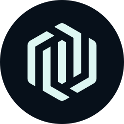

# Longtail (TAIL) token artwork



These assets represent Longtail (`TAIL`) on BNB Smart Chain mainnet (chain ID `56`), at `0xa11A111A3100DDe3224995982643CA592111AA11`. See the [deployment record](../../deployments/bsc-mainnet/Token.json).

## Files

| File | Dimensions | Use |
| --- | --- | --- |
| [tail.svg](tail.svg) | Scalable; 256 × 256 viewBox | Original master artwork, preserved unchanged; preferred for vector-capable integrations. |
| [tail-32.png](tail-32.png) | 32 × 32 | Compact token lists. |
| [tail-64.png](tail-64.png) | 64 × 64 | Token lists and small icons on high-density displays. |
| [tail-128.png](tail-128.png) | 128 × 128 | Wallet and application icons. |
| [tail-200.png](tail-200.png) | 200 × 200 | Token listing submissions and profiles. |
| [tail-256.png](tail-256.png) | 256 × 256 | General-purpose token icon. |
| [tail-512.png](tail-512.png) | 512 × 512 | Larger displays and asset submissions. |
| [tail-1024.png](tail-1024.png) | 1024 × 1024 | High-resolution raster artwork. |
| [tail.ico](tail.ico) | 16, 32, and 48 pixels square | Multi-resolution browser favicon. |

The pale symbol (`#DDF6F2`) sits on a dark circular background (`#07101A`); the corners outside the circle are transparent. PNG exports use RGBA and preserve the SVG's composition. The SVG declares an intrinsic size of 8192 × 8192; set display dimensions in your application. Each PNG is rendered directly from the vector master at its target size.

Choose the format and dimensions required by the receiving application. Committing these assets does not automatically update wallets or explorers.

## Regenerating exports

The exports were generated with CairoSVG `2.8.2` and Pillow `11.3.0`. These are optional artwork tools, separate from the contract project's npm dependencies. CairoSVG also requires the native Cairo library.

From the repository root, with those tools installed in a separate Python environment:

```python
from io import BytesIO
from pathlib import Path

import cairosvg
from PIL import Image

assets = Path("assets/token")
for size in (32, 64, 128, 200, 256, 512, 1024):
    cairosvg.svg2png(
        url=str(assets / "tail.svg"),
        write_to=str(assets / f"tail-{size}.png"),
        output_width=size,
        output_height=size,
    )

frames = [
    Image.open(BytesIO(cairosvg.svg2png(
        url=str(assets / "tail.svg"), output_width=size, output_height=size
    )))
    for size in (16, 32, 48)
]
frames[-1].save(
    assets / "tail.ico",
    sizes=[(16, 16), (32, 32), (48, 48)],
    append_images=frames[:-1],
)
```

After regeneration, check dimensions, transparent corners, and appearance at the intended display size. Keep the SVG as the source of truth.
